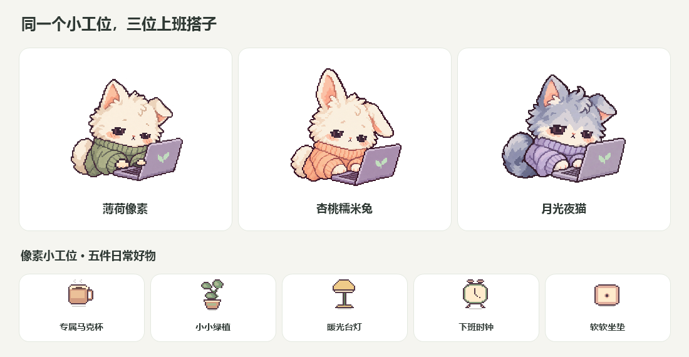
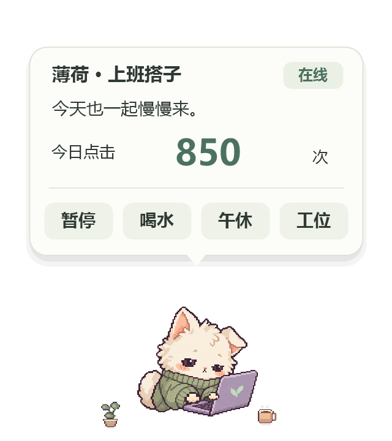
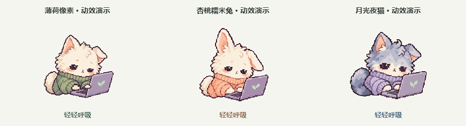

# 上班搭子

一只住在桌面角落的小搭子：你的鼠标每点一下，它就跟着忙一下。记录点击次数，慢慢攒币，把小工位布置得更可爱。

A tiny Windows desktop companion with global mouse click counting, animated pixel pets, and a cozy little workspace. Built with C# / WinForms, entirely local, no network required.



## 运行

适用于 64 位 Windows 10 / 11，使用系统 .NET Framework 4.x。

在仓库 Releases 下载 `OfficeBuddyStudio-v0.8.0-windows-x64.zip`，解压后运行；GitHub 的 Source code 包需要先构建。

双击 `OfficeBuddyStudio.exe`，默认显示小号透明桌宠。将鼠标移到搭子上，展开今日计数与暂停、喝水、午休、工位操作；移到浮层上可继续操作，移开立即隐藏，不延时停留。拖动搭子移动位置，右键或托盘菜单可调整大小、切换外观、隐藏或退出。

- **薄荷像素**：像素猫与薄荷色浮层；自动眨眼，瞳孔跟随鼠标。左键 / 左侧键带动左手，右键 / 右侧键带动右手，中键带动双手。左右手动作独立，连续点击不会互相覆盖。午休时闭眼，停止敲击，计数仍继续。
- **杏桃糯米兔 / 月光夜猫**：使用用户提供的角色图，支持眨眼、眼神跟随、左右手独立敲击、喝水与午休。三款共用固定眼眶、移动瞳孔的眼睛动画；手掌纹理叠加在身体底图上，袖口随手掌移动，笔记本保持固定。
- **装饰**：五件原创像素装饰，商店与桌宠共用图案。已购买的物品可收起或摆上，不重复扣币；旧存档保留原有购买和布置记录。
- **工位窗口**：概览、工位装饰、外观三个页签。关闭窗口会返回桌宠；完整退出请使用右键菜单的「退出」。
- **角色和文字独立缩放**：角色提供迷你、小号、中号；文字提供 100%、120%、140%。
- **点击穿透**：透明部分不拦截下方应用；整个角色穿透可在右键菜单开启。双击托盘图标恢复交互。





演示图放大展示动作，桌宠默认仍为小号。

## 怎么计数

左键、右键、中键和两个侧键，按下一次记一次；双击记两次。移动、滚动和松开不计数。软件自身按钮的点击也会统计。喝水、午休是陪伴动作，计数仍继续；「暂停」才会停止计数。隐藏或最小化后继续统计。

每 100 次点击攒 1 枚搭子币，每日最多 20 枚。工位提供杯子、绿植、台灯、时钟和坐垫。点击量是趣味记录，不用于衡量工作效率。

## 数据

所有记录保存在 `%LOCALAPPDATA%\OfficeBuddy\save.json`，兼容之前版本的存档。保存每日各按键次数、累计次数、币、已购装饰、布置状态和外观设置；不保存鼠标坐标、窗口标题、键盘或点击序列。运行时不联网、不自动开机启动。

每 5 秒保存，正常退出时保存，并保留上一份备份。强制结束进程或断电可能损失最后约 5 秒记录。损坏存档会保留原文件并尝试从备份恢复。

## 从源码构建

在本目录执行：

```powershell
powershell -NoProfile -ExecutionPolicy Bypass -File .\build.ps1
powershell -NoProfile -ExecutionPolicy Bypass -File .\verify.ps1
```

`build.ps1` 使用 Windows 自带的 .NET Framework C# 编译器，无需 NuGet。像素素材嵌入 EXE，运行无需单独复制素材目录。`verify.ps1` 检查悬停显示与隐藏、计数、奖励、存档与迁移；加 `-Overlay` 在有桌面的 Windows 会话中验证透明窗口、点击命中、外观切换和字号缩放。

## 项目文件

| 文件 | 用途 |
|---|---|
| `OfficeBuddy.cs` | WinForms 窗口、Raw Input、渲染、计数、存档及检查入口 |
| `SpriteMotion.cs` | 两款用户角色的手掌和袖口动画合成 |
| `PixelEye.cs` | 三款共用的固定眼眶、瞳孔跟随和眨眼 |
| `PixelDecor.cs` | 商店与桌宠共用的五件像素装饰 |
| `assets/` | 原始像素素材，保留透明通道 |
| `application.manifest` | Per-Monitor V2 DPI 与普通用户权限 |
| `build.ps1` / `verify.ps1` | 构建与验证 |
| `DESIGN.md` | 设计资料与改版依据 |
| `ASSETS.md` | 素材来源及生成提示词 |
| `package.ps1` | 清单导出源码和便携运行包 |
| `PUBLISH.md` / `CONTRIBUTING.md` | GitHub 发布和参与说明 |

预览使用演示数据，不读取真实存档。窗口拖动位置暂不跨启动保存。未逐一验证混合 DPI 多屏、全屏独占游戏、远程桌面及特殊输入设备。程序目前未做代码签名。

## 检查动效

在 Windows 上用程序生成独立姿势，再通过 Pillow 检查眼睛和手部区域的实际变化：

```powershell
.\OfficeBuddyStudio.exe --motion-frames .\work\motion
py .\check-motion.py .\work\motion
```

图像检查需要 Python 和 Pillow，运行搭子与构建程序不需要它们。图像检查覆盖向左 / 向右看、眨眼、左右手独立运动、双手同时运动、休息闭眼和透明背景；窗口检查同时覆盖点击触发与动画推进。

## 打包与开源

```powershell
powershell -NoProfile -ExecutionPolicy Bypass -File .\package.ps1
```

导出到 `work/packages`：一个可直接初始化 Git 的源码目录、源码 ZIP 和 Windows 运行 ZIP。清单包含当前文档和素材，排除 EXE（源码包）、旧预览、临时数据与个人存档。相同版本的 ZIP 已存在时会停止，可指定新的 `-OutputDirectory`。GitHub Actions 会构建、执行功能检查并导出 ZIP；桌面窗口与图像检查在本地 Windows 会话运行。

项目采用 [MIT 许可证](LICENSE)，素材来源见 [ASSETS.md](ASSETS.md)，版本记录见 [CHANGELOG.md](CHANGELOG.md)。首次发布步骤见 [PUBLISH.md](PUBLISH.md)。
