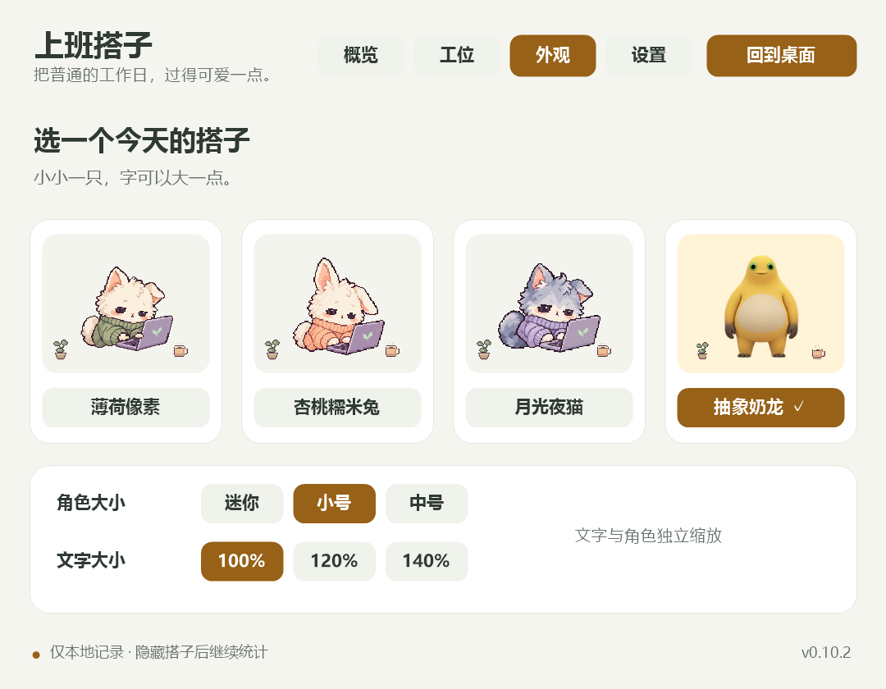
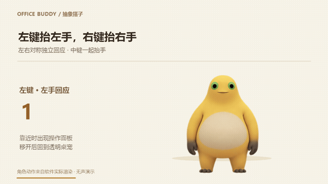

<h1 align="center">上班搭子 · Office Buddy</h1>

<p align="center">你的鼠标每点一下，它就陪你忙一下。<br>把普通的工作日，过得可爱一点。</p>

<p align="center">
  <a href="https://github.com/YapengEcho/office-buddy/actions/workflows/build.yml"></a>
  
  <a href="LICENSE"></a>
</p>

<p align="center">
  <a href="#下载与运行">下载与运行</a> · <a href="#功能">功能</a> · <a href="#操作">操作</a> · <a href="#常见问题">常见问题</a> · <a href="#开发">开发</a> · <a href="https://github.com/YapengEcho/office-buddy/issues">反馈</a>
</p>

一款 Windows 桌面陪伴软件：小搭子直接住在桌面上，跟着鼠标点击做动作，帮你记下每天的点击、攒币布置工位，也提醒你喝水和休息。鼠标移到角色上才展开操作浮层，移开就收起。

An offline Windows desktop companion with mouse-reactive animation, click statistics, workspace decorations, and optional work reminders.

<p align="center"></p>

演示使用独立数据并放大展示动作；桌宠默认小号，角色大小和文字大小可分别调整。

## 下载与运行

**支持 Windows 10 / 11（x64），使用系统 .NET Framework 4.x，解压即用。**

当前源码版本为 **v0.10.2**，运行包通过 GitHub Actions 提供，仓库目前没有正式 Release。

1. 打开 [Windows 构建页面](https://github.com/YapengEcho/office-buddy/actions/workflows/build.yml?query=branch%3Amain)，选择 **main 分支最近一次成功的运行**。
2. 登录 GitHub，在该运行页面底部的 **Artifacts** 下载 `OfficeBuddyStudio-windows-x64`。
3. 解压下载文件，再解压里面的 `OfficeBuddyStudio-v0.10.2-windows-x64.zip`，双击 `OfficeBuddyStudio.exe`。

构建附件还包含源码 ZIP；`office-buddy-…-source.zip` 和 GitHub 的 **Code → Download ZIP** 都需要先[从源码构建](#开发)。Actions 附件有保存期限，过期时可从源码构建。下载规则见 [GitHub 官方说明](https://docs.github.com/en/actions/how-tos/manage-workflow-runs/download-workflow-artifacts)。

第一次运行后，把鼠标移到搭子上，点击「工位」看看装饰和统计；右键角色打开「设置…」，选择你喜欢的大小、外观和提醒。程序目前未做代码签名。

## 功能

| 你可以做什么 | 搭子会怎么回应 |
| --- | --- |
| **点击也有陪伴** | 左右鼠标键分别驱动左右手，动作独立；像素搭子会眨眼、跟随鼠标看，奶龙会托腮、抱臂和捧腹大笑。 |
| **记下今天的小忙碌** | 统计五个鼠标按键，查看今日、累计与月度趋势；可导出 CSV。 |
| **慢慢布置小工位** | 每 100 次点击获得 1 枚搭子币，每日最多 20 枚；解锁杯子、绿植、台灯、时钟和坐垫，买过的装饰可反复摆上或收起。 |
| **一起休息一下** | 手动喝水、午休，或空闲后自动小睡、回来时醒来；可设置喝水、休息和下班提醒，支持勿扰及延后 10 分钟。 |
| **放在顺手的角落** | 拖动移动、位置记忆、位置锁定和找回；可调动作幅度、角色与文字大小，设置显示 / 隐藏快捷键和开机启动。 |
| **把记录留在自己电脑上** | 离线运行、本地存档，支持 JSON 备份与恢复；可选择排除软件自身的点击。 |

工作提醒和开机启动默认关闭；点击次数用于趣味记录，不用于衡量工作效率。

<details>
<summary>看看四款搭子、工位和月度统计</summary>




</details>

## 操作

| 操作 | 效果 |
| --- | --- |
| 鼠标移到角色 / 移开浮层 | 显示 / 收起今日计数与互动按钮；移到浮层上可以继续操作。 |
| 拖动角色 | 移动桌宠，自动记住位置；锁定位置后不能拖动。 |
| 右键角色或托盘图标 | 打开设置、切换外观、调整大小、隐藏、点击穿透或退出。 |
| `Ctrl+Alt+B` | 显示 / 隐藏桌宠；可在设置中更换或关闭。 |
| 双击托盘图标 | 恢复桌宠交互，包括关闭整个角色的点击穿透。 |
| 关闭工位窗口 | 返回桌宠；完整退出请在右键或托盘菜单选择「退出」。 |

**四款外观：**薄荷像素、杏桃糯米兔、月光夜猫、抽象奶龙。可从外观页切换，也可用运行包内对应的 `.cmd` 启动；已有实例时会切换该实例的外观。

抽象奶龙不带电脑，左键 / 左侧键抬左手，右键 / 右侧键抬右手，中键同时抬手。快速连续点击 5 次会触发约 3.6 秒的大笑，自动触发间隔至少 8 秒；右键菜单也能手动触发。喝水、午休状态优先，暂停时不触发点击动作。

<details>
<summary>看看悬停浮层、奶龙大笑和左右手响应</summary>

<p align="center"></p>

<p align="center"></p>

<p align="center"></p>

</details>

更多日常使用说明见 [RUNNING.md](RUNNING.md)。

## 计数与隐私

- **按下一次记一次：**左键、右键、中键和两个侧键；双击记两次。移动、滚动、松开不计数。
- **暂停才停止计数：**喝水、午休、自动睡眠和隐藏后继续统计。默认统计软件自身点击，可在「设置 → 统计与存档」取消。
- **只保存统计与偏好：**每日各按键次数、累计次数、搭子币、装饰、位置和设置；不保存点击坐标、窗口标题、具体键盘按键或点击序列，运行时不联网。自动睡眠只读取系统最后活动时间。
- **本地存档：**`%LOCALAPPDATA%\OfficeBuddy\save.json`，升级沿用原记录；每 5 秒及正常退出时保存，并保留上一份备份。强制结束或断电可能损失最后约 5 秒记录。
- **导出与恢复：**设置中可导出带 BOM 的 UTF-8 CSV（便于 Excel 打开）或备份 JSON。恢复先验证并确认，再另存当前记录；恢复不会改写本机开机启动选项。损坏存档会保留原文件并尝试从备份恢复。

## 常见问题

<details>
<summary>找不到搭子，或者搭子跑到屏幕外了？</summary>

先试 `Ctrl+Alt+B`（如果已更换快捷键，使用新组合），或双击托盘图标恢复。仍不可见时，从托盘打开「设置…」，使用「找回桌宠位置」。显示器工作区改变后，程序也会自动把搭子移回可见区域。

</details>

<details>
<summary>点击后没有动作，或者点不到搭子？</summary>

检查是否暂停、手动午休，以及动作幅度设置。奶龙在喝水或午休时优先显示对应动作。开启整个角色的点击穿透后，双击托盘图标恢复交互；透明背景本身始终允许点击下方窗口。

</details>

<details>
<summary>怎样升级、保留数据或彻底退出？</summary>

在「设置 → 统计与存档」备份，随后从托盘正常退出旧版，解压新版并运行。记录位于本地应用数据目录，升级会继续使用它。关闭工位窗口只返回桌宠；停止后台计数需要选择菜单中的「退出」。

</details>

<details>
<summary>支持 macOS、Linux、自定义角色导入或键盘统计吗？</summary>

目前支持 Windows x64 和四款内置外观，没有自定义角色导入、键盘计数或 AI 对话功能。真实混合 DPI 多屏、全屏独占游戏、远程桌面与特殊输入设备仍需进一步验证；遇到问题欢迎提交复现信息。

</details>

## 开发

使用 **C# / WinForms、Windows Raw Input 与透明分层窗口**。构建使用 Windows 自带的 .NET Framework C# 编译器，无需 NuGet；素材嵌入 EXE。在 Windows PowerShell 中运行：

```powershell
git clone https://github.com/YapengEcho/office-buddy.git
cd office-buddy
powershell -NoProfile -ExecutionPolicy Bypass -File .\build.ps1
powershell -NoProfile -ExecutionPolicy Bypass -File .\verify.ps1
.\OfficeBuddyStudio.exe
```

`verify.ps1` 使用独立测试数据，检查计数、存档、提醒、位置和动画等功能。透明窗口与点击命中检查需有桌面的 Windows 会话，运行前从托盘退出日常实例：

```powershell
powershell -NoProfile -ExecutionPolicy Bypass -File .\verify.ps1 -Overlay
powershell -NoProfile -ExecutionPolicy Bypass -File .\package.ps1
```

打包输出到 `work/packages`，包含源码目录、源码 ZIP 和 Windows 便携 ZIP；使用文件清单排除个人存档、Git 文件及临时数据。同版本 ZIP 已存在时，可用 `-OutputDirectory` 指定新的输出目录。GitHub Actions 自动构建、验证、打包。

| 文档 | 内容 |
| --- | --- |
| [CONTRIBUTING.md](CONTRIBUTING.md) | 反馈、贡献、四款角色验证与图像检查 |
| [CHANGELOG.md](CHANGELOG.md) | 各版本变化 |
| [ASSETS.md](ASSETS.md) | 像素角色、装饰的来源与生成提示词 |
| [NAILONG-NOTES.md](NAILONG-NOTES.md) | 奶龙素材来源、权利说明与演示视频复现 |
| [DESIGN.md](DESIGN.md) | 设计资料与改版依据 |

## 参与和许可

欢迎在 [Issues](https://github.com/YapengEcho/office-buddy/issues) 提交问题和建议，或按[贡献指南](CONTRIBUTING.md)提交 Pull Request。反馈请附 Windows 版本、显示缩放、角色和复现步骤，截图遮住个人信息；请勿提交个人存档。

**代码采用 [MIT](LICENSE)。** 原有角色与装饰素材说明见 [ASSETS.md](ASSETS.md)；抽象奶龙是参考第三方形象制作的实验素材，相关名称和角色权利归其权利人，MIT 代码许可证不授予第三方角色许可，详见 [NAILONG-NOTES.md](NAILONG-NOTES.md)。

文档布局参考了 [BongoCat](https://github.com/ayangweb/BongoCat) 的演示与简洁功能介绍，以及 [VPet](https://github.com/LorisYounger/VPet) 的互动展示和代码 / 素材许可说明。
